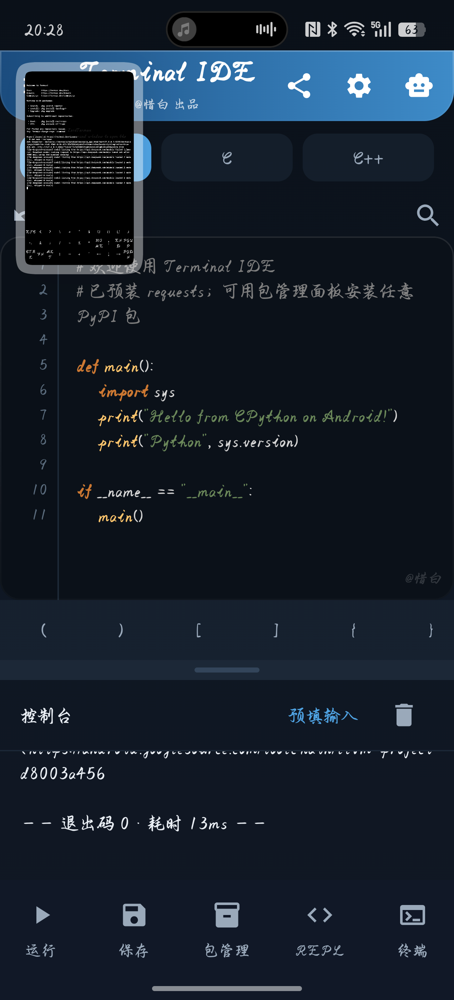
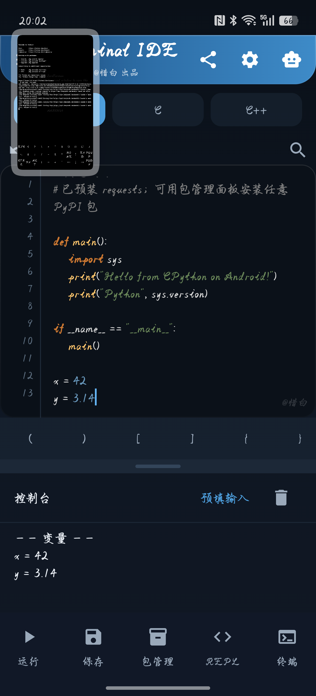
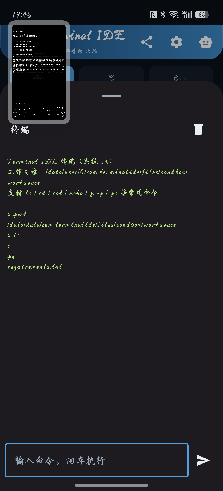

# TerminalIDE

> 手机上真的能写代码的 IDE —— Python 运行 + Python REPL + 本地 AI 助手 + 移动端代码编辑器

一个 **Telegram 风格**的 Android 移动端 IDE，内置 **CPython 3.13** 与 **llama.cpp 推理引擎**，
让你在手机上写、跑、调试 Python，还能和**本地离线 / 在线 AI** 边聊边写代码。

**作者：@惜白**

---

---

## 📸 截图

<p align="center">
  
  
  
</p>

---

## ✨ 功能特性

### 🐍 Python 运行
- 内置 **CPython 3.13**（Chaquopy 嵌入式），开箱即用，无需外部环境
- **交互式控制台**：程序运行时可实时输入（`input()` 生效），输出流式显示
- **Python REPL**：底部导航「REPL」入口，输入一行即执行，**变量跨次保留**（`1+1` → `2`）
- **多文件项目**：代码目录加入 `sys.path`，支持 `import` 同目录模块
- 「预填输入」批量喂数据、输出自动滚动到最新
- 运行期 **pip 安装任意 PyPI 包**（官方 / 清华 / 阿里 / 中科大镜像一键切换）
- 预装常用库：`requests` `beautifulsoup4` `tqdm` `colorama` `rich`

### 🤖 AI 助手
- **本地离线模型**：内置 llama.cpp 推理引擎，可下载 DeepSeek-R1 蒸馏模型（1.5B / 7B）
- **DeepSeek 官方 API**：V3（`deepseek-chat`）/ R1（`deepseek-reasoner`），支持**流式输出**
- **AI 快捷操作**：解释代码 · 修复错误 · 优化 · 加注释 · 生成测试（模型未就绪时自动置灰）
- **AI 分析报错**：运行报错后一键把「代码 + traceback」交给 AI，给出修复方案
- **应用并运行**：AI 给的修复代码可一键替换 + 重跑，形成「报错 → 分析 → 修复 → 重跑」闭环
- AI 回复中的代码块可**一键插入编辑器**
- API Key 使用 `EncryptedSharedPreferences`（AES256）加密存储

### ✏️ 编辑器
- Python / C / C++ 语法高亮 + 行号 + 圆角卡片
- **代码符号工具条**：手机键盘缺失的 `( ) [ ] { } : " ' = + - * / #` 等一键输入
- **括号自动配对** + **回车自动缩进**（Python `:` 后自动缩进 4 空格）
- **编辑器 / 控制台可拖动分隔条**，自由调整比例
- **自动保存**：停止输入 1.5 秒自动存盘，防丢代码
- 文件树、保存、新建文件、`.py` 文件关联（打开方式）
- **文件管理**：长按文件可重命名 / 删除
- **代码导出**：顶栏分享按钮 →「分享为文件」或「复制代码」

### ⚡ 性能与稳定
- **输出环形缓冲**：上限 30 万字符，大输出不再 O(n²) 卡顿
- **语法高亮上限**：超 6 万字符自动跳过高亮，大文件不掉帧
- **死循环中断**：`sys.settrace` 每行检查中断标志，「停止」能真正打断 `while True: pass`
- **输入超时保护**：程序等待输入 10 分钟无响应自动 EOF，防止线程永久挂起
- **崩溃保护**：启动异常显示在界面而非闪退，崩溃日志落盘

### 🎨 界面
- Telegram 风格深色主题、圆角渐变顶栏、胶囊式语言切换
- 底部导航（运行 / 保存 / 包管理 / REPL）
- **多语言**：简体中文 / English / 繁體中文 / 日本語（设置内可切换）
- 鲸鱼娘自适应图标、`@惜白` 水印


### 📡 抓包工具（v1.25+）
- **内置 HTTP/HTTPS 抓包代理**：`127.0.0.1:8888`，无需外部工具
- **HTTPS 解密**：自签 CA + 按域名签发证书，实现 TLS 中间人（需要安装 CA）
- **前台服务保活**：代理跑在前台服务里，通知栏常驻，不易被系统回收
- **白名单 / 黑名单**：黑名单域名**透明转发不解密**（默认预置微信 / QQ / 支付宝 / 银联）
- **一键隐藏**：token / cookie / password 自动打码，防截图泄露
- **一键清代理**：立刻清除系统代理，恢复网络直连
- **AI 解析接口**：把抓到的请求交给 AI，分析接口用途、关键参数，并生成 `requests` 代码
- **一键重放**：原样重发请求，查看响应
- **CA 安装**：App 内一键装到系统级（Android 14+ 走 APEX 注入）

> 详细说明与证书安装方法见 [`capture-module/README.md`](capture-module/README.md)

---


## 📥 下载安装

前往 **[Releases](https://github.com/yzxcrush/TerminalIDE/releases)** 下载最新 APK（当前 **v1.28.2**）：

| 项目 | 说明 |
|---|---|
| 架构 | **arm64-v8a**（64 位 ARM） |
| 最低系统 | **Android 7.0（API 24）** |
| 目标系统 | Android 15（API 35） |
| 大小 | 约 37MB |
| 签名 | 固定 PKCS12 证书（支持就地升级、不丢已下载模型） |

> 首次使用 AI：在「设置 → AI 后端」填入 DeepSeek API Key，或下载本地模型离线使用。

---


## 🔐 系统证书安装（抓包 HTTPS 解密必需）

抓包工具要解密 HTTPS，必须让系统信任它生成的自签 CA。提供三种方式：

### 方式一：App 内一键安装（推荐）
1. 抽屉 ☰ → 📡 抓包 → 点「**开始抓包**」（自动生成 CA）
2. 点「**装系统证书**」→ 自动完成 APEX 注入
3. 重启相关 App 使其重新加载信任库

> 重启手机后失效，需重新点一次。

### 方式二：KernelSU / Magisk 模块（持久化）
把 CA 放进模块后重启，开机自动安装：

```bash
# 详见 capture-module/README.md
cp <hash>.0 /data/adb/modules/terminalide_ca/system/etc/security/cacerts/
```

模块脚本内置**安全校验**：证书数 < 50 时中止，不会破坏系统信任库。

### 方式三：手动安装（无 root）
App 内「导出 CA」→ 系统设置 → 安全 → 加密与凭据 → 安装证书 → CA 证书

> 此方式只对信任用户证书的 App 生效（浏览器可用，多数 App 不行）。

📖 **完整安装说明 → [capture-module/README.md](capture-module/README.md)**

⚠️ **风险提示**
- 安装系统 CA 后，理论上任何持有该 CA 私钥的人都能劫持你的 HTTPS 流量
- **不要在抓包状态下登录微信 / 银行 / 支付类账号**
- 不用时请删除模块并重启，或在抓包面板点「一键清代理」

---

## 📝 更新日志

### v1.28.2（抓包安全重构）
- **修复**：代理随 Activity 销毁导致系统代理残留 → 手机「断网、只能用流量」
- **新增**：抓包代理改为**前台服务**，通知栏常驻，大幅降低被杀风险
- **新增**：服务销毁自动清除系统代理；App 启动自检；**开机自愈**残留代理
- **修复**：App 内「装系统证书」在 Android 14+ 无效（改为 APEX 注入 + 安全校验）
- **修复**：普通 HTTP 转发使用 origin-form；服务销毁阻塞主线程；若干编译错误

### v1.27.0（抓包过滤）
- **新增**：抓包**白名单 / 黑名单**
- 黑名单域名**透明转发、根本不解密**，TLS 连接保持加密
- 默认预置：微信 / QQ / 支付宝 / 银联

### v1.26.0（抓包安全加固）
- **新增**：「一键隐藏」敏感信息打码（token / cookie / password）
- **新增**：「一键清代理」红按钮
- **修复**：停止抓包时自动清系统代理；`execRoot` 改用临时脚本避免引号解析

### v1.25.3（抓包工具）
- **新增**：内置 HTTP/HTTPS 抓包代理 + TLS 中间人解密
- **新增**：抓包列表 / 详情 / AI 解析 / 一键重放
- **新增**：自签 CA 生成与导出

### v1.15.2
- ✨ **Python REPL**（底部导航入口，变量跨次保留）
- ⚡ **AI 流式输出**（DeepSeek API SSE 逐字显示）
- ⚡ **输出环形缓冲**（30 万字符上限，大输出不卡）
- ⚡ **语法高亮上限**（6 万字符跳过，大文件不掉帧）
- 💾 **自动保存**（1.5 秒防抖）
- 🛡 **输入超时**（10 分钟无响应自动 EOF）
- 🔘 AI 快捷操作未就绪时置灰
- 🔠 符号工具条加大（40dp）
- 🐛 修复 REPL 面板半展开导致输入框被裁

### v1.13.4
- 🎛 交互输入条改为 Pydroid 3 风格（固定底部，不被遮挡）
- 🐛 修复停止按钮无法解除 `input()` 阻塞
- 🐛 修复括号自动配对重复插入
- 📐 编辑器 / 控制台可拖动分隔条

### v1.12.1
- 🎨 添加 `@惜白` 水印（顶栏署名 + 编辑器水印）

### v1.12.0
- 🔠 代码符号工具条
- ✨ AI 快捷操作（解释 / 修复 / 优化 / 注释 / 测试）
- 🧩 括号自动配对 + 回车自动缩进

### v1.11.1
- 🔐 固定签名证书（可就地升级、不丢数据）
- 📜 输出自动滚动、模型下载断点续传
- 🔗 文件关联（`.py` 打开方式）
- 📦 预装 requests / beautifulsoup4 / tqdm / colorama / rich

### v1.10.0
- ⌨️ 标准输入（stdin）支持，交互式程序可输入

### v1.9.0
- 🧠 内置 llama.cpp 推理引擎，支持本地 DeepSeek-R1 模型

### v1.8.0
- 🐳 鲸鱼娘应用图标

### v1.7.0
- 🎨 UI 美化（渐变顶栏 / 胶囊 Tab / 底部导航 / 圆角编辑器）
- 🤖 AI 侧边栏新增 DeepSeek-R1 推理模型

### v1.6.0
- 新增 DeepSeek-R1 支持

### v1.5.0
- 🐛 修复启动闪退（语法高亮正则分组 bug）

---

## 🛠 技术栈

| 组件 | 选型 |
|---|---|
| UI | Jetpack Compose + Material 3 |
| Python 运行时 | Chaquopy（CPython 3.13） |
| 本地推理 | llama.cpp（随 APK 打包在 jniLibs） |
| AI 服务 | DeepSeek API（OpenAI 兼容协议，SSE 流式） |
| 包管理 | 运行期 pip（`--target` 沙箱 site-packages） |
| 签名 | 固定 PKCS12 证书（支持就地升级、不丢数据） |
| CI/CD | GitHub Actions（自动构建 + 签名 + Release） |

---

## 🔧 从源码构建

前置：JDK 17、Android SDK（compileSdk 35）、Python 3.13（Chaquopy 构建期用）

```bash
# 1) 克隆
git clone https://github.com/yzxcrush/TerminalIDE.git
cd TerminalIDE

# 2) 一键构建 + 签名（自动生成/使用固定证书）
chmod +x scripts/*.sh
./scripts/build_release.sh

# 3) 产物
# release/TerminalIDE-arm64-v8a-release.apk
```

也可以直接推送到 `main`，GitHub Actions 会自动构建并上传产物。

---

## 📁 目录结构

```
TerminalIDE/
├── app/src/main/
│   ├── java/com/terminalide/
│   │   ├── ai/          # AI 后端：本地 llama.cpp + DeepSeek API（含流式）
│   │   ├── backend/     # 语言后端：Python/C/C++ 执行 + 交互 IO 桥
│   │   ├── core/        # 沙箱/设置/语言定义
│   │   ├── packages/    # 镜像源 + pip 包管理
│   │   └── ui/          # Compose 界面 + ViewModel（含 REPL）
│   ├── python/          # ide_runner.py（交互执行 + REPL）+ pip_runner.py
│   ├── jniLibs/         # llama.cpp 推理引擎
│   └── res/             # 鲸鱼娘图标等资源
├── scripts/build_release.sh   # 构建 + zipalign + apksigner
├── signing/terminalide.p12    # 固定签名证书
└── .github/workflows/         # GitHub Actions 自动打包
```

---

## ⚠️ 已知限制

### 抓包工具的限制
- **证书固定**：微信 / 支付宝 / 银行等 App 有 Pinning，HTTPS 解密会失败（所有 MITM 工具都一样）
- **系统 CA 重启失效**：App 内「装系统证书」用的是内存挂载，重启手机后需重装（KSU 模块可持久化）
- **仅限授权目标**：只能抓你自己设备 / 已授权目标的流量


- **C/C++ 编译**：受 Android 10+ SELinux 限制（禁止 App 执行私有目录中的二进制），
  需将 clang 工具链打入 APK（+135MB）才能启用，当前暂未开启。
- **文件关联**：`content://` 形式可用；`file://` 形式受分区存储限制。
- **本地模型**：7B 模型约 4.7GB，下载耗时较长，建议在 WiFi 下进行。
- **AI 流式**：目前仅 DeepSeek API 支持；本地 llama.cpp 仍为「生成完再显示」。

---

## 🗺️ Roadmap

- [ ] 查找 & 替换
- [ ] 本地模型流式输出
- [ ] AI 对话持久化
- [ ] 基础调试器（断点 / 单步）
- [ ] 深/浅主题 + 字号调节
- [ ] 代码片段库
- [ ] 执行可视化（逐行看变量变化）

---

## 📄 License

MIT License

---

Made with ❤️ by **@惜白**
